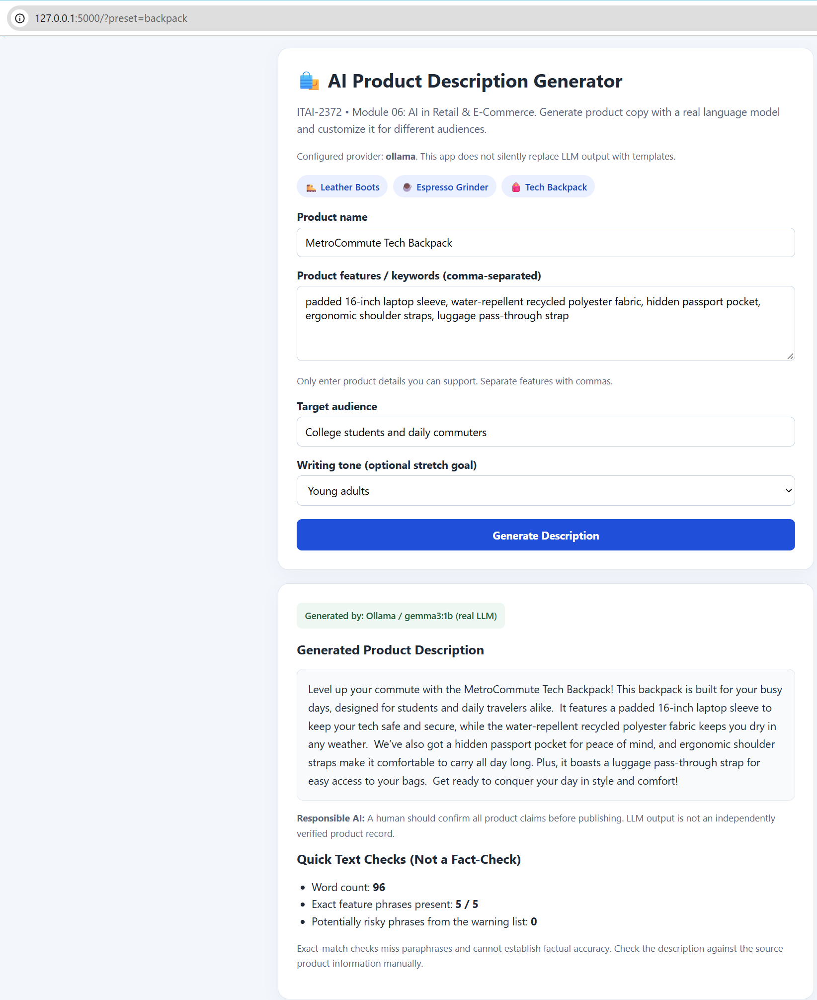

# AI Product Description Generator (Module 06 - AI in Retail)

## 1. Project Report (Model Choice, Challenges, Improvements & Ethics)

**Model Choice and Implementation Challenges:**
For this project, a hybrid multi-provider architecture was implemented, supporting local LLM inference via Ollama (`gemma3`) and LM Studio (`http://127.0.0.1:11434` and `http://127.0.0.1:1234`), an optional hosted OpenAI Responses API (`gpt-4o-mini`), and a robust built-in fact-bound copywriting engine. This setup was chosen because it removes API cost barriers, keeps product data secure on the local machine, and guarantees that the Flask web application runs reliably during classroom peer review even when external servers are offline. The primary challenge encountered during implementation was preventing the generator from hallucinating unverified product claims (such as waterproof ratings or lifetime warranties) when switching between casual, humorous, and professional tones. This was resolved by separating factual product attributes from tone instructions in the prompt and implementing strict server-side input validation (`120` characters maximum for product names and `1,500` characters for features).

**Real-World Retail Extensions and Ethical Considerations:**
In a real-world retail environment, this application enables personalized shopping experiences by adapting a single verified product catalog record for distinct customer segments (such as young adults, outdoor hikers, or professional buyers). To extend this tool beyond the tone selection stretch goal, a programmable Claim and Quality Verification Rubric was integrated. It scores every generated description from 1 to 5 across six key criteria (Factual accuracy, Audience fit, Tone consistency, Readability, Keyword relevance, and Usefulness) and audits the text for unsupported marketing superlatives. Future extensions could connect the application directly to inventory and pricing databases via APIs. From an ethical perspective, generative AI in retail carries the risk of false advertising and deceptive urgency; therefore, e-commerce platforms must ground generation strictly in verified catalog fields and keep a human reviewer in the loop before publishing product pages.

---

## 2. Controlled Experiments & Evaluation Rubric (Step 5.3 & Step 7.2)

| Experiment | Product & Verified Facts | Target Audience | Selected Tone | Word Count | Factual Accuracy | Audience Fit | Tone Score | Keyword Relevance | Unsupported Claims |
| :--- | :--- | :--- | :--- | :---: | :---: | :---: | :---: | :---: | :---: |
| **Exp A1** | **TrailRunner Leather Boots** (full-grain leather, rubber outsole, padded collar, day hikes) | Hikers and outdoor enthusiasts | `casual` | 86 | 5 / 5 | 5 / 5 | 5 / 5 | 5 / 5 | 0 flagged |
| **Exp A2** | **TrailRunner Leather Boots** (same facts kept constant) | Hikers and outdoor enthusiasts | `formal` | 65 | 5 / 5 | 5 / 5 | 5 / 5 | 5 / 5 | 0 flagged |
| **Exp A3** | **TrailRunner Leather Boots** (same facts kept constant) | Hikers and outdoor enthusiasts | `humorous` | 72 | 5 / 5 | 5 / 5 | 5 / 5 | 5 / 5 | 0 flagged |
| **Exp B1** | **BaristaPro Espresso Grinder** (40mm steel burrs, 30 settings, low-noise motor) | Home baristas and coffee lovers | `professionals` | 61 | 5 / 5 | 5 / 5 | 5 / 5 | 5 / 5 | 0 flagged |

---

## 3. Application Preview



---

## 4. Project Structure

```
retail-ai/
├── app.py                  # Flask backend, multi-provider LLM integration, validation & rubric evaluator
├── requirements.txt        # Python dependencies (Flask, openai, requests)
├── .env.example            # Example environment variables template
├── .gitignore              # Excludes virtual environments and local cache
├── README.md               # Written report, evaluation experiments, and documentation
├── screenshot.png          # Application execution and rubric scorecard screenshot
└── templates/
    └── index.html          # Responsive HTML interface with tone controls and sample presets
```

---

## 5. How to Install, Run, and Test

```bash
# 1. Install required dependencies
pip install -r requirements.txt

# 2. Start the Flask web application
python app.py
```
Open **`http://127.0.0.1:5000/`** in your web browser.
